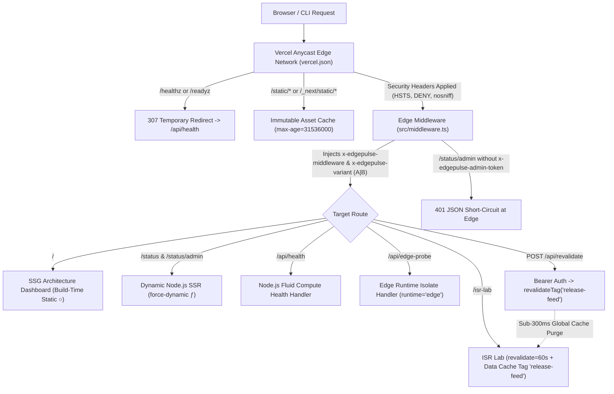

# EdgePulse Deploy (`edgepulse-deploy`)

**Live Production Deployment:** https://edgepulse-deploy.vercel.app

**EdgePulse Deploy** is a production-grade **Next.js (App Router) + TypeScript** observability, edge routing, and rendering strategy showcase engineered for **Vercel**. It demonstrates—both visually in the browser and programmatically via live endpoints—how modern Next.js applications combine **Static Site Generation (`SSG`)**, **Incremental Static Regeneration (`ISR`) with tag-based cache purges (`revalidateTag`)**, **Dynamic Node.js Server Rendering (`SSR`)**, **Edge Runtime isolates**, **Edge Middleware**, **`vercel.json` security/routing rules**, and **GitHub Actions prebuilt CI/CD automation**.

---

## Why This Project Exists

In production Next.js deployments on Vercel, subtle misconfigurations across caching layers, compute runtimes, and environment scopes cause some of the hardest-to-diagnose incidents:

1. **Rendering & Cache Confusion:** Accidentally opting an entire application out of static caching by reading dynamic headers in a root layout, or serving stale ISR content because cache tags and CDN `Cache-Control` rules conflict.
2. **Node.js vs. Edge Runtime Boundaries:** Knowing when to use lightweight WinterCG Web APIs at the network boundary (`src/middleware.ts`, `runtime = 'edge'`) versus full **Node.js Fluid Compute** for backend routes (`/api/health`, `/api/revalidate`).
3. **Environment Variable & Secret Hygiene:** Distinguishing build-time browser-inlined `NEXT_PUBLIC_*` config from server-only secrets (`REVALIDATE_SECRET`, `EDGEPULSE_ADMIN_TOKEN`), and inspecting deployment readiness without leaking secret values into HTML or logs.
4. **Deterministic Prebuilt CI/CD:** Building once in CI (`vercel pull` -> `vercel build` -> `vercel deploy --prebuilt`) and gating releases with automated post-deploy `/api/health` smoke checks.

EdgePulse Deploy turns every one of those platform primitives into an interactive, inspectable, and fully tested reference architecture.

---

## End-to-End Request Lifecycle



---

## Interactive Pages & API Endpoints

### 1. Pages (`src/app/`)

| Route               | Rendering Strategy                | What It Demonstrates                                                                                                                                                                                                                                                                                                                                                                |
| :------------------ | :-------------------------------- | :---------------------------------------------------------------------------------------------------------------------------------------------------------------------------------------------------------------------------------------------------------------------------------------------------------------------------------------------------------------------------------- |
| **`/`**             | **Static (`SSG` `○`)**            | Prerendered at build time for instant CDN TTFB. Compares `SSG`, `ISR`, `SSR`, and `Edge` trade-offs, displays deployment metadata (`VERCEL_ENV`, `VERCEL_REGION`, `VERCEL_GIT_COMMIT_SHA`), and embeds an interactive **Node.js vs. Edge Runtime Probe** with `?variant=A\|B` sticky cookie overrides.                                                                              |
| **`/isr-lab`**      | **ISR (`revalidate = 60`)**       | Fetches release notes tagged with `next: { tags: ['release-feed'], revalidate: 60 }`. Displays the cached `generatedAt` timestamp and `snapshotId` alongside an interactive client trigger calling `POST /api/revalidate` to demonstrate instant global cache invalidation via `revalidateTag('release-feed')`.                                                                     |
| **`/status`**       | **Dynamic (`SSR` `ƒ`)**           | Runs per-request on Node.js (`export const dynamic = 'force-dynamic'`). Inspects the active server runtime (`Node.js` version, OS/arch), verifies middleware header propagation, measures live round-trip `/api/health` latency, provides an interactive `/status/admin` header probe, and audits required/optional/system environment variables with **zero-leak secret masking**. |
| **`/status/admin`** | **Protected Dynamic (`SSR` `ƒ`)** | Protected behind `src/middleware.ts`. Unauthenticated requests are rejected at the Edge with HTTP `401`; requests carrying a valid `x-edgepulse-admin-token` header pass through to the server component.                                                                                                                                                                           |

### 2. Route Handlers (`src/app/api/`)

| Endpoint                                             | Runtime                       | Behavior & Response Contract                                                                                                                                                                                                                                                                                      |
| :--------------------------------------------------- | :---------------------------- | :---------------------------------------------------------------------------------------------------------------------------------------------------------------------------------------------------------------------------------------------------------------------------------------------------------------- |
| **`GET /api/health`** _(also `/healthz`, `/readyz`)_ | **Node.js**                   | Returns `200 OK` (`Cache-Control: no-store`) with service status, Node.js version, `VERCEL_ENV`, `VERCEL_REGION`, `commitSha`, process uptime, and UTC timestamp. Used by CI post-deploy smoke checks.                                                                                                            |
| **`GET /api/edge-probe`**                            | **Edge (`runtime = 'edge'`)** | Executes in a WinterCG Edge V8 isolate. Echoes Vercel request/geo headers (`x-vercel-id`, `x-vercel-ip-country`, `x-vercel-ip-city` with clean local fallbacks), middleware variant state, and `performance.now()` execution timing.                                                                              |
| **`POST /api/revalidate`**                           | **Node.js**                   | Validates `Authorization: Bearer <token>` (or `x-revalidate-token`) using constant-time string comparison against `REVALIDATE_SECRET` (with safe `local-demo-secret` fallback **only** outside production). Returns `401` on invalid/missing credentials and `200` after calling `revalidateTag('release-feed')`. |
| **`GET /api/release-feed`**                          | **Node.js**                   | Internal release notes JSON feed consumed by `/isr-lab` via tagged `fetch` caching (with automatic `x-vercel-protection-bypass` support and offline prerender fallback).                                                                                                                                          |

---

## Project Structure

```text
edgepulse-deploy/
├── .github/workflows/
│   ├── ci.yml                      # Push & PR gate: tsc --noEmit, eslint, vitest, next build
│   └── vercel-deploy.yml           # Prebuilt Preview (PR) & Production (main) deploy + /api/health smoke test
├── docs/
│   └── vercel-runbook.md           # Operations runbook: env scoping, promotion/rollback, DNS/TLS, 5 playbooks
├── public/static/
│   └── observability-badge.svg     # Static asset served with immutable 1-year Cache-Control
├── src/
│   ├── app/
│   │   ├── api/
│   │   │   ├── edge-probe/route.ts # Edge Runtime header & timing probe
│   │   │   ├── health/route.ts     # Node.js structured health telemetry endpoint
│   │   │   ├── release-feed/route.ts
│   │   │   └── revalidate/route.ts # Authenticated revalidateTag('release-feed') endpoint
│   │   ├── isr-lab/page.tsx        # ISR Cache & On-Demand Revalidation Lab
│   │   ├── status/
│   │   │   ├── admin/page.tsx      # Middleware-protected admin diagnostics page
│   │   │   └── page.tsx            # Deployment Health & Environment Inspector
│   │   ├── globals.css             # Tailwind + Grotesk & JetBrains Mono typography system
│   │   ├── layout.tsx              # Static-safe Root Layout (preserves child SSG/ISR caching)
│   │   └── page.tsx                # Architecture Overview & Strategy Matrix
│   ├── components/
│   │   ├── AdminGateProbeCard.tsx  # Interactive x-edgepulse-admin-token header tester
│   │   ├── HealthLatencyCard.tsx   # Client-to-origin /api/health latency meter
│   │   ├── MiddlewareVariantPill.tsx # Live-synced navbar A/B variant indicator
│   │   ├── Navbar.tsx              # Responsive navigation & stage/region badges
│   │   ├── RevalidateControls.tsx  # Interactive cache purge & 401 token test panel
│   │   └── RuntimeProbePanel.tsx   # Side-by-side Node.js vs Edge probe runner
│   ├── lib/
│   │   ├── env-diagnostics.ts      # Edge-safe metadata, constant-time auth & secret masking
│   │   ├── node-runtime.ts         # Node-only runtime version helper (isolated from Edge bundle)
│   │   └── release-feed.ts         # Tagged fetch + offline-resilient unstable_cache layer
│   └── middleware.ts               # Pre-cache header injection, sticky variant cookie & admin gate
├── tests/
│   ├── env-diagnostics.test.ts     # Secret masking, prod vs dev env validation & vercel.json checks
│   ├── middleware.test.ts          # Variant precedence, cookie persistence & /status/admin 401/200 tests
│   └── routes.test.ts              # Unit tests for /api/health, /api/edge-probe & /api/revalidate
├── .env.example                    # Documented environment variable template
├── vercel.json                     # Security headers, redirects, static caching, Fluid Compute & regions
└── package.json
```

---

## Typography & Visual Design

The interface uses a high-contrast dark observability palette paired with a **Grotesk** typographic hierarchy:

- **Headings & Display (`font-display`):** `Bricolage Grotesque` (`-0.025em` tracking) for sharp architectural hierarchy.
- **Body & Controls (`font-sans`):** `Space Grotesk` (`-0.012em` tracking) for crisp technical UI legibility.
- **Telemetry, Headers, & Payloads (`font-mono`):** `JetBrains Mono` (ligatures disabled) for SHAs, HTTP headers, latencies, and JSON payloads.

---

## Environment Variables & Secret Hygiene

Copy `.env.example` to `.env.local` for local overrides (or run `vercel env pull .env.local` when linked to Vercel):

| Variable                                                 | Category | Scope           | Local Dev Fallback                      | Description                                                                                     |
| :------------------------------------------------------- | :------- | :-------------- | :-------------------------------------- | :---------------------------------------------------------------------------------------------- |
| `NEXT_PUBLIC_APP_NAME`                                   | Required | `public-build`  | `"EdgePulse Deploy"`                    | Browser-visible app title inlined at `next build` time.                                         |
| `REVALIDATE_SECRET`                                      | Required | `server-secret` | `"local-demo-secret"` _(non-prod only)_ | Authorizes `POST /api/revalidate`. Fails closed (`401`) in production if unset.                 |
| `EDGEPULSE_ADMIN_TOKEN`                                  | Required | `server-secret` | `"local-admin-token"` _(non-prod only)_ | Authorizes `/status/admin` in `src/middleware.ts`. Fails closed (`401`) in production if unset. |
| `NEXT_PUBLIC_DEPLOYMENT_CHANNEL`                         | Optional | `public-build`  | `"local-observability"`                 | Release channel label displayed in runtime telemetry cards.                                     |
| `OBSERVABILITY_WEBHOOK_URL`                              | Optional | `server-secret` | _(unset)_                               | Optional webhook sink for synthetic deployment alerts.                                          |
| `LOG_SAMPLING_RATE`                                      | Optional | `server-config` | _(unset)_                               | Optional server-side trace sampling ratio (`0.0`–`1.0`).                                        |
| `VERCEL_ENV` / `VERCEL_REGION` / `VERCEL_GIT_COMMIT_SHA` | System   | `platform`      | Safe local defaults                     | Auto-injected by Vercel at build and runtime.                                                   |

---

## Getting Started Locally

### Prerequisites

- **Node.js** `>= 22.0.0` (Node.js 26 LTS recommended on Vercel)
- **npm** `>= 10`

### 1. Install & Run Development Server

```bash
cp .env.example .env.local
npm install
npm run dev
```

Open http://localhost:3000 in your browser:

- Visit **`/isr-lab`** and click **Purge release-feed Cache** (pre-filled with `local-demo-secret` in local dev) to watch the server-rendered snapshot timestamp refresh immediately, or click **Test Invalid Token (Expect 401)** to verify auth rejection.
- Visit **`/status`** to inspect masked environment variables and probe `/status/admin` with and without `x-edgepulse-admin-token`.

### 2. CLI `curl` Verification Recipes

```bash
# 1. Node.js health check & security/middleware headers
curl -i https://edgepulse-deploy.vercel.app/api/health

# 2. Verify /healthz redirect defined in vercel.json
curl -iL https://edgepulse-deploy.vercel.app/healthz

# 3. Edge Runtime probe with query-based A/B variant override (?variant=B)
curl -i "https://edgepulse-deploy.vercel.app/api/edge-probe?variant=B"

# 4. Verify Middleware 401 protection on /status/admin
curl -i https://edgepulse-deploy.vercel.app/status/admin

# 5. Trigger authenticated ISR cache invalidation
curl -i -X POST https://edgepulse-deploy.vercel.app/api/revalidate \
  -H "Authorization: Bearer $REVALIDATE_SECRET"
```

### 3. Run Quality & Build Verification Gates

```bash
npx tsc --noEmit   # Strict TypeScript check (strict, noUnusedLocals, noUnusedParameters)
npm run lint       # ESLint + @next/eslint-plugin-next (--max-warnings 0)
npm test           # Vitest unit & route handler suite (routes, middleware, env-diagnostics)
npm run build      # Optimized Next.js production build
```

---

## CI/CD & Operations Runbook

- **Continuous Integration ([`.github/workflows/ci.yml`](./.github/workflows/ci.yml)):** Runs typechecking, zero-warning linting, unit/route tests, and a production build on every push and pull request.
- **Vercel Prebuilt Deployment ([`.github/workflows/vercel-deploy.yml`](./.github/workflows/vercel-deploy.yml)):** Uses `vercel pull`, `vercel build`, and `vercel deploy --prebuilt` (requires `VERCEL_TOKEN`, `VERCEL_ORG_ID`, and `VERCEL_PROJECT_ID` repository secrets, plus optional `VERCEL_AUTOMATION_BYPASS_SECRET`), followed by an automated retry-capable HTTP smoke test against `/api/health`.
- **Operations Runbook ([`docs/vercel-runbook.md`](./docs/vercel-runbook.md)):** Detailed guide covering environment variable scoping, staged production promotions (`--skip-domain` + `vercel promote`) & instant rollbacks, custom domain `A`/`CNAME` DNS & Let's Encrypt SSL verification, and step-by-step troubleshooting for 5 common Next.js/Vercel production issues.
